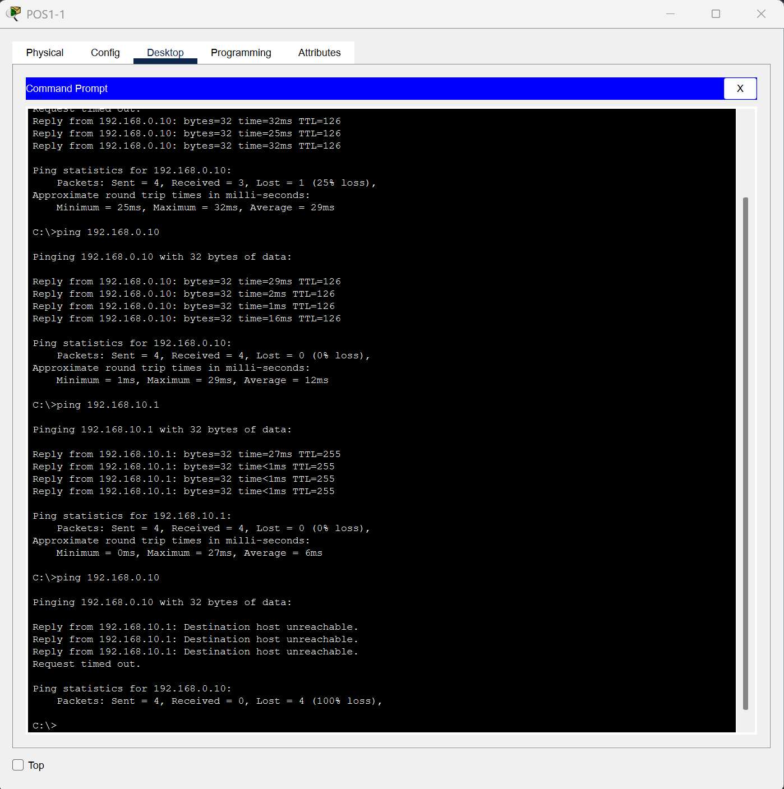
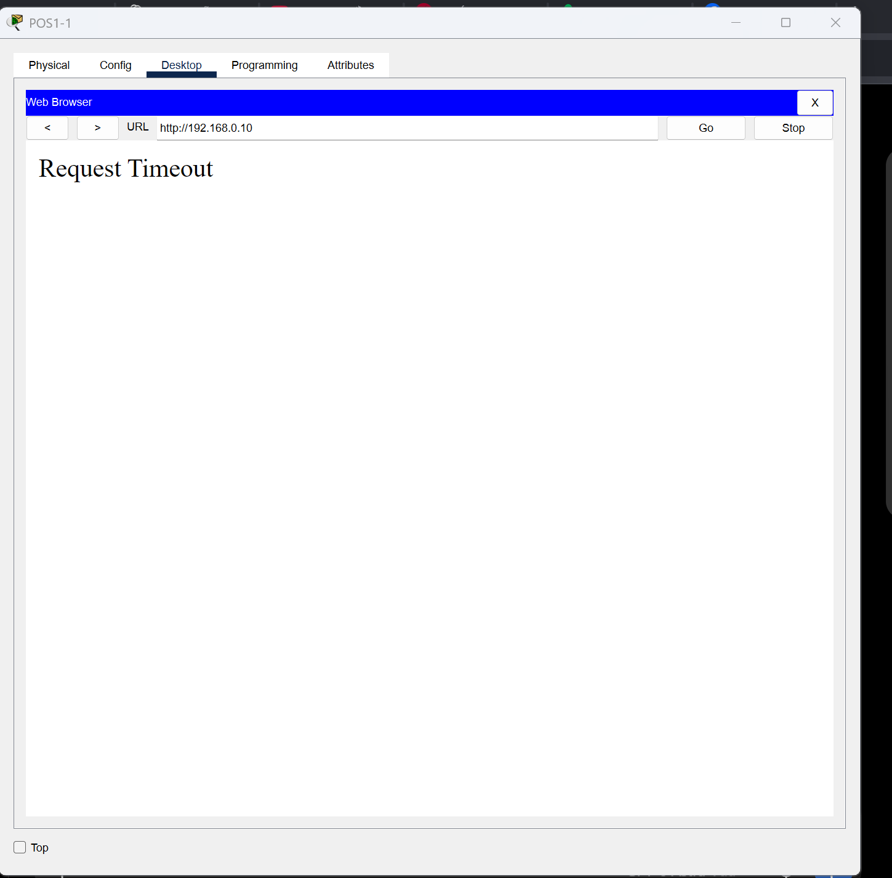
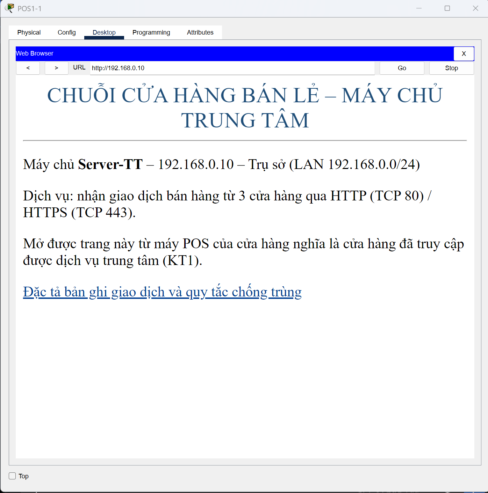

# BÁO CÁO PHẦN THỰC HIỆN CỦA THÀNH VIÊN 3

**Đề tài:** Thiết kế hạ tầng CNTT cho chuỗi cửa hàng bán lẻ  
**Sinh viên:** Phan Hải Đức  
**Mã sinh viên:** B24DCCC072  
**Lớp:** D24CQCC06-B  
**Nội dung phụ trách:** Lưu cục bộ giao dịch, gửi lại khi mất kết nối, chống ghi trùng và kiểm tra sao lưu/phục hồi dữ liệu.

> Đây là nội dung phần việc của TV3 để ghép vào báo cáo nhóm. Các kết quả Python/SQLite và Packet Tracer được trình bày riêng theo đúng phạm vi đã kiểm thử.

## 1. Nhiệm vụ và phạm vi thực hiện

Trong mô hình chuỗi cửa hàng bán lẻ, giao dịch được tạo ở máy POS của cửa hàng và chuyển về trụ sở. Nếu dịch vụ nhận tại trụ sở tạm thời không truy cập được, giao dịch không được phép mất. Khi dịch vụ hoạt động trở lại, cửa hàng cần gửi tiếp những giao dịch chưa được xác nhận và tránh lưu trùng ở trụ sở.

Phần em phụ trách gồm: xây dựng cơ chế lưu giao dịch tại cửa hàng bằng SQLite; viết chương trình nhận giao dịch ở trụ sở qua HTTP POST; xử lý trạng thái xác nhận và gửi lại; kiểm tra chống ghi trùng; xuất CSV, sao lưu và kiểm thử phục hồi CSDL; bổ sung chương trình tự động gửi lại theo chu kỳ. Em cũng thực hiện minh chứng mất kết nối/khôi phục mạng trên bản Packet Tracer V2 của nhóm.

Môi trường triển khai gồm Python 3, SQLite và các thư viện có sẵn trong Python. Bản demo có một cửa hàng `CH01`, một máy bán hàng `POS01` và một trụ sở, chạy trên cùng máy tính. Dữ liệu được gửi dưới dạng JSON đến `http://127.0.0.1:8000/giao-dich`. Mô hình Packet Tracer dùng để kiểm tra kết nối mạng, **không phải đường truyền mà chương trình Python đang sử dụng**.

## 2. Thiết kế và cơ chế hoạt động

### 2.1. Lưu giao dịch tại cửa hàng

File `Script/store_agent.py` tạo giao dịch và ghi vào `DuLieu/cuahang01.db` trước khi thử gửi. Bảng `giao_dich` lưu mã giao dịch, mã cửa hàng, mã máy, thời gian, số tiền và trạng thái. Mỗi giao dịch được gán mã theo dạng:

```text
CH01-POS01-YYYYMMDD-XXXXXX
```

Trong đó, `XXXXXX` là số thứ tự trong ngày. Bảng `bo_dem` lưu số cuối theo ngày, nên khi đóng rồi mở lại chương trình, số thứ tự không bị đặt lại. Việc tăng bộ đếm và thêm giao dịch được thực hiện trong một giao dịch SQLite có sử dụng `BEGIN IMMEDIATE`.

Tại cửa hàng, cơ sở dữ liệu có ràng buộc số tiền lớn hơn 0. Khi nhận giao dịch, chương trình trụ sở kiểm tra số tiền phải là số nguyên dương. Trường `ma_gd` là khóa chính để phân biệt các giao dịch.

### 2.2. Trạng thái và cách xử lý khi gửi

| Trạng thái | Ý nghĩa |
|---|---|
| `PENDING` | Đã lưu ở cửa hàng, chưa thử gửi |
| `SENT` | Đã thử gửi nhưng chưa nhận ACK hợp lệ; chưa thể kết luận trụ sở đã lưu hay chưa |
| `ACKED` | Đã nhận ACK hợp lệ và đúng mã giao dịch |

Chương trình chỉ chọn những giao dịch có trạng thái `PENDING` hoặc `SENT` để gửi. Trước khi gửi, trạng thái chuyển sang `SENT`. Nếu dịch vụ không truy cập được hoặc phản hồi chưa hợp lệ, chương trình giữ nguyên bản ghi để gửi lại ở lần sau. Chỉ khi phản hồi có `ack = true` và `ma_gd` đúng với mã đang gửi thì cửa hàng mới cập nhật `ACKED`.

### 2.3. Nhận dữ liệu và chống ghi trùng tại trụ sở

File `Script/hq_receiver.py` tiếp nhận yêu cầu HTTP POST, kiểm tra các trường dữ liệu và lưu vào `DuLieu/truso.db`. Tại trụ sở, `ma_gd` là khóa chính.

- Nếu là mã giao dịch mới, trụ sở lưu bản ghi rồi trả xác nhận `DA_LUU`.
- Nếu cùng mã và nội dung của cả 5 trường đều giống dữ liệu đã lưu, trụ sở trả `DA_TON_TAI` và ACK, không thêm bản ghi mới.
- Nếu cùng mã nhưng nội dung khác, chương trình có nhánh phản hồi HTTP `409` để báo xung đột.

Cơ chế này xử lý được tình huống cửa hàng gửi lại một giao dịch đã được trụ sở nhận, ví dụ khi phản hồi xác nhận đến cửa hàng bị gián đoạn. Việc ghi dữ liệu thành công được thực hiện trước khi trả ACK.

### 2.4. Tự động gửi lại theo chu kỳ

Ban đầu, em phải gọi lệnh gửi thủ công. Sau khi hoàn thành các ca kiểm thử cơ bản, em bổ sung `Script/auto_sync.py` để quá trình này tự chạy. Chương trình gọi `gui_giao_dich()` và **chờ 10 giây sau mỗi lượt xử lý** rồi mới kiểm tra tiếp. Khi dịch vụ trụ sở hoạt động trở lại, các giao dịch còn chờ sẽ được tự động thử gửi lại mà không cần nhập lại lệnh thủ công.

Để lưu dấu vết chạy chương trình, em tạo `chay_auto_sync.ps1` sử dụng `Tee-Object`: vừa hiển thị nội dung ở Terminal, vừa ghi vào `MinhChung/TuDong/auto_sync_log.txt`. Đây là file log được tạo khi chạy chương trình, không phải một công việc sao lưu CSDL tự động.

### 2.5. Xuất dữ liệu, sao lưu và phục hồi

- `Script/xuat_giao_dich.py`: đọc dữ liệu giao dịch từ CSDL cửa hàng và xuất CSV vào `DuLieu/Xuat`.
- `Script/sao_luu.py`: dùng chức năng `backup` của SQLite, tạo bản sao trong `DuLieu/SaoLuu` và kiểm tra `PRAGMA integrity_check`.
- `Script/kiem_tra_phuc_hoi.py`: phục hồi từ bản sao vào `DuLieu/PhucHoiThu`, đối chiếu bảng `giao_dich`, bảng `bo_dem` và kiểm tra toàn vẹn, không ghi đè CSDL đang sử dụng.

Các thao tác xuất CSV và sao lưu hiện vẫn được chạy bằng lệnh thủ công, chưa có lịch tự động.

## 3. Kết quả kiểm thử

### 3.1. Kiểm thử lưu cục bộ, gửi lại và chống trùng

Bộ kiểm thử chính sử dụng 15 giao dịch trong hai CSDL của demo TV3. Kết quả được lưu ở `MinhChung/README.md` và các tệp log tương ứng.

| Ca kiểm thử | Thao tác | Kết quả ghi nhận |
|---|---|---|
| **KT2 – Mất dịch vụ nhận** | Dừng `hq_receiver.py`, tạo thêm 5 giao dịch rồi thử gửi | 5 giao dịch mới từ `PENDING` sang `SENT`, gặp `WinError 10061`; cửa hàng vẫn giữ đủ 15 giao dịch (10 cũ + 5 mới) |
| **KT3 – Dịch vụ phục hồi** | Khởi động lại trụ sở và gửi lại 5 giao dịch còn chờ bằng lệnh thủ công | Trụ sở tăng từ 10 lên 15 giao dịch; cửa hàng có 15 `ACKED`, dữ liệu 5 trường giữa hai bên khớp |
| **KT3-b – Gửi lặp** | Gửi lại toàn bộ 15 giao dịch đã đồng bộ | Nhận 15 phản hồi `DA_TON_TAI` hợp lệ; trụ sở vẫn có 15 giao dịch, không thêm mã trùng |

**Minh chứng:**

- KT2: [`KT2_PENDING_20261101.txt`](MinhChung/KT2_PENDING_20261101.txt), [`KT2_GUI_LOI_20261101.txt`](MinhChung/KT2_GUI_LOI_20261101.txt).
- KT3: [`KT3_TRUOC_GUI_20261101.txt`](MinhChung/KT3_TRUOC_GUI_20261101.txt), [`KT3_GUI_LAI_20261101.txt`](MinhChung/KT3_GUI_LAI_20261101.txt), [`KT3_SAU_GUI_20261101.txt`](MinhChung/KT3_SAU_GUI_20261101.txt).
- KT3-b: [`KT3b_GUI_LAP_20261101.txt`](MinhChung/KT3b_GUI_LAP_20261101.txt).

### 3.2. Kiểm thử tự động đồng bộ trên bản sao riêng

Để không ảnh hưởng bộ dữ liệu 15 giao dịch ở dự án gốc, em tạo một bản thử nghiệm độc lập, khởi tạo 5 giao dịch mới và kiểm tra chức năng tự động gửi lại.

Khi dịch vụ trụ sở chưa chạy, `auto_sync.py` tự phát hiện 5 giao dịch cần gửi, gặp lỗi `WinError 10061` và vẫn giữ dữ liệu trong SQLite. Sau khi chạy lại `hq_receiver.py`, chương trình tự gửi những giao dịch này. Log trụ sở ghi nhận đủ 5 lần `DA_LUU`, mỗi yêu cầu nhận phản hồi HTTP `200`.

Kết quả đối chiếu sau khi đồng bộ:

| Tiêu chí | Kết quả |
|---|---:|
| Số giao dịch tại cửa hàng | 5 |
| Số giao dịch `ACKED` tại cửa hàng | 5 |
| Số giao dịch tại trụ sở | 5 |
| Bản ghi chỉ có ở cửa hàng | 0 |
| Bản ghi chỉ có ở trụ sở | 0 |
| So sánh 5 trường dữ liệu | Khớp hoàn toàn |

Khi không còn giao dịch chờ, chương trình tiếp tục kiểm tra các lượt tiếp theo; phần ghi log bằng PowerShell cũng đã được kiểm tra và hoạt động. Thử nghiệm này chứng minh cơ chế tự gửi lại khi **dịch vụ nhận trên localhost** dừng rồi hoạt động lại; chưa phải phép thử qua mạng WAN thực tế.

**Minh chứng:**

- [`TV3_TuDong_TruSo_Nhan5GD.png`](MinhChung/TuDong/TV3_TuDong_TruSo_Nhan5GD.png): log trụ sở nhận 5 giao dịch và trả HTTP 200.
- [`TV3_TuDong_DoiChieu_5GD.png`](MinhChung/TuDong/TV3_TuDong_DoiChieu_5GD.png): kết quả đối chiếu hai CSDL, 5/5 ACKED.
- `MinhChung/TuDong/auto_sync_log.txt`: được tạo khi chạy `chay_auto_sync.ps1`, dùng để lưu log cho các lần thử tiếp theo.

### 3.3. Minh chứng kết nối trên Packet Tracer V2

Em dùng mô hình `PacketTracer/Nhom02_TV3_KiemThu_TuBanV2.pkt` để kiểm tra tình huống mất đường WAN. Khi tắt các cổng Serial0/0/0 và Serial0/0/1 của R-CH1, máy POS1-1 vẫn ping được gateway `192.168.10.1` nhưng không ping được trụ sở `192.168.0.10`, đồng thời HTTP tới trụ sở bị timeout. Khi bật lại các cổng, truy cập HTTP được khôi phục.







Đây là minh chứng kiểm thử hạ tầng mạng trong Packet Tracer. Chương trình Python/SQLite được chạy độc lập trên laptop, không đi qua các cổng WAN mô phỏng này.

### 3.4. Kiểm thử xuất CSV, sao lưu và phục hồi

Bộ dữ liệu dùng cho phần kiểm thử này là bản có **10 giao dịch**, khác thời điểm so với bộ 15 giao dịch ở KT2–KT3.

| Nội dung | Kết quả |
|---|---|
| Xuất CSV | Xuất 10 giao dịch, đều `ACKED` |
| Sao lưu SQLite | Tạo bản sao chứa 10 giao dịch, `integrity_check = ok` |
| Phục hồi vào file riêng | Bảng `giao_dich` khớp 10 bản ghi, bảng `bo_dem` khớp 1 bản ghi |
| Kiểm tra toàn vẹn file phục hồi | `integrity_check = ok` |

Log đối chiếu: [`xuat_giao_dich.txt`](MinhChung/xuat_giao_dich.txt), [`sao_luu.txt`](MinhChung/sao_luu.txt), [`kiem_tra_phuc_hoi.txt`](MinhChung/kiem_tra_phuc_hoi.txt).

Các bản sao lưu ngày 26/10 không phải bản sao mới nhất của bộ dữ liệu 15 giao dịch. Chúng không được dùng làm bằng chứng đã sao lưu CSDL trụ sở của TV2.

## 4. Hướng dẫn chạy và kiểm tra

Thực hiện các lệnh dưới đây tại thư mục gốc `nmcnnt`. Cần cài Python 3; các script hiện dùng thư viện chuẩn của Python, không cần cài thêm gói ngoài cho phần demo này.

**Chạy dịch vụ nhận tại trụ sở** trong một Terminal:

```powershell
python Script/hq_receiver.py
```

**Tạo hoặc xem giao dịch** ở Terminal khác:

```powershell
python Script/store_agent.py
```

Chọn `1` sẽ tạo thêm 5 giao dịch mẫu, còn chọn `2` chỉ xem dữ liệu đã lưu. **Không chọn `1` trong bộ dữ liệu 15 giao dịch gốc nếu không chủ định bổ sung bản ghi mới.**

**Gửi thủ công** (dùng cho ca thử cũ hoặc khi cần kiểm tra riêng một lần gửi):

```powershell
python -c "from Script.store_agent import gui_giao_dich, xem_giao_dich; gui_giao_dich(); xem_giao_dich()"
```

**Chạy tự động và lưu log** trong một Terminal khác, trên bản dữ liệu phù hợp:

```powershell
powershell -NoProfile -ExecutionPolicy Bypass -File .\chay_auto_sync.ps1
```

Để dừng các chương trình đang chạy, chọn đúng Terminal và nhấn `Ctrl + C`. File `auto_sync_log.txt` được tạo dưới `MinhChung/TuDong` khi chạy lệnh PowerShell ở trên.

**Kiểm thử gửi trùng** (chỉ khi hai bên đang khớp và receiver hoạt động):

```powershell
python Script/kiem_tra_trung.py
```

**Xuất CSV, sao lưu và thử phục hồi** khi cần:

```powershell
python Script/xuat_giao_dich.py
python Script/sao_luu.py
python Script/kiem_tra_phuc_hoi.py
```

Các phép thử làm thay đổi dữ liệu nên thực hiện trên bản sao riêng. Đặc biệt, không dùng bộ dữ liệu thử nghiệm 5 giao dịch để ghi đè hai CSDL 15 giao dịch của dự án gốc.

## 5. File bàn giao của TV3

| Đường dẫn | Nội dung |
|---|---|
| `Script/store_agent.py` | Tạo và lưu giao dịch cục bộ, quản lý trạng thái, gửi và kiểm tra ACK |
| `Script/hq_receiver.py` | Nhận HTTP POST, ghi SQLite, ACK và xử lý giao dịch trùng |
| `Script/kiem_tra_trung.py` | Kiểm tra gửi lặp và đối chiếu dữ liệu hai phía |
| `Script/auto_sync.py` | Tự kiểm tra và gửi lại giao dịch còn chờ |
| `chay_auto_sync.ps1` | Chạy đồng bộ và ghi log ra file |
| `Script/xuat_giao_dich.py` | Xuất giao dịch ra CSV |
| `Script/sao_luu.py` | Sao lưu SQLite |
| `Script/kiem_tra_phuc_hoi.py` | Kiểm tra phục hồi và tính toàn vẹn dữ liệu |
| `DuLieu/cuahang01.db`, `DuLieu/truso.db` | Hai CSDL của demo TV3 (bộ dữ liệu gốc 15 giao dịch) |
| `MinhChung/`, `MinhChung/TuDong/` | Log và ảnh kiểm thử |
| `PacketTracer/Nhom02_TV3_KiemThu_TuBanV2.pkt` | Bản Packet Tracer V2 dùng cho kiểm thử mạng |
| `README_TV3.md` | Hướng dẫn vận hành và danh mục các phần TV3 |

## 6. Đánh giá kết quả và giới hạn

Qua các bước thực hiện, em đã hoàn thành phần lưu giao dịch ở cửa hàng, chuyển dữ liệu tới trụ sở và xử lý gửi lại khi dịch vụ nhận không truy cập được. Các ca KT2, KT3 và KT3-b đã chứng minh giữ dữ liệu, gửi lại và không ghi trùng trong bộ 15 giao dịch. Việc bổ sung `auto_sync.py` giúp bỏ thao tác gọi lệnh gửi lại thủ công; bản thử riêng có 5 giao dịch đều được xác nhận, và dữ liệu hai phía khớp hoàn toàn.

Phần sao lưu và kiểm thử phục hồi giúp kiểm tra dữ liệu SQLite trước và sau khi tạo bản sao. Ngoài ra, các hình ảnh Packet Tracer V2 bổ sung minh chứng cho tình huống mất kết nối mạng và phục hồi HTTP ở lớp hạ tầng.

Một số giới hạn còn tồn tại:

- Bản demo Python sử dụng `127.0.0.1`, hiện mới có một cửa hàng `CH01` và một máy `POS01`; chưa chạy đồng thời nhiều máy POS hay nhiều điểm bán.
- Chưa tích hợp CSDL demo TV3 với CSDL và luồng xử lý thực tế của TV2. Cần thống nhất cấu trúc bảng, giao thức và quy trình tích hợp trước khi kết luận hệ thống nhóm hoạt động xuyên suốt.
- Chưa có phép kiểm thử riêng cho tình huống cùng mã khác nội dung (HTTP 409) và trường hợp mất phản hồi ACK sau khi trụ sở đã commit.
- Chức năng tự đồng bộ mới được kiểm tra qua dịch vụ localhost, chưa kiểm thử qua WAN Packet Tracer; phần sao lưu vẫn thực hiện thủ công.
- Bản phục hồi đã đối chiếu dữ liệu và bộ đếm, nhưng chưa kiểm thử tạo thêm giao dịch bằng chương trình cửa hàng ngay trên file phục hồi.

Những giới hạn trên là cơ sở để nhóm tiếp tục hoàn thiện khi ghép các thành phần của TV1, TV2 và TV3. Khi đưa vào báo cáo nhóm chính thức, cần bổ sung phiên bản công cụ thực dùng, tài liệu tham khảo và nội dung công khai việc sử dụng công cụ hỗ trợ (nếu môn học yêu cầu).

---

## Phụ lục C. Mã nguồn và cấu trúc CSDL

Các đoạn mã dưới đây được giữ theo bản nguồn đã dùng để lập minh chứng. Khi nộp dự án, các file `.py` và `.ps1` riêng trong repository mới là mã nguồn cần chạy; phụ lục hỗ trợ người đọc đối chiếu chức năng.

### C.1. `store_agent.py`

```python
import json
from urllib.request import Request, urlopen
from urllib.error import URLError
from datetime import datetime
import sqlite3
from pathlib import Path
# Xác định thư mục gốc của dự án nmcnnt
THU_MUC_GOC = Path(__file__).resolve().parent.parent
# File cơ sở dữ liệu của cửa hàng 01
FILE_DB = THU_MUC_GOC / "DuLieu" / "cuahang01.db"

def khoi_tao():
    # Tạo thư mục dữ liệu nếu chưa có
    FILE_DB.parent.mkdir(parents=True, exist_ok=True)
    # Mở cơ sở dữ liệu; nếu chưa có file thì SQLite tự tạo
    ket_noi = sqlite3.connect(FILE_DB)
    # Mỗi giao dịch có một mã duy nhất, không được trùng
    ket_noi.execute("""
        CREATE TABLE IF NOT EXISTS giao_dich (
            ma_gd TEXT PRIMARY KEY,
            ma_cua_hang TEXT NOT NULL,
            ma_may TEXT NOT NULL,
            thoi_gian TEXT NOT NULL,
            so_tien INTEGER NOT NULL CHECK (so_tien > 0),
            trang_thai TEXT NOT NULL DEFAULT 'PENDING'
                CHECK (trang_thai IN ('PENDING', 'SENT', 'ACKED'))
        )
    """)
    ket_noi.commit()
    ket_noi.close()
    print("Da khoi tao kho luu giao dich cua cua hang 01.")
    print("Vi tri:", FILE_DB)

def tao_giao_dich(so_tien):
    hien_tai = datetime.now()
    ngay = hien_tai.strftime("%Y%m%d")
    thoi_gian = hien_tai.isoformat(timespec="seconds")
    ket_noi = sqlite3.connect(FILE_DB)
    try:
        # Lưu số thứ tự vào SQLite để mở lại chương trình không bị reset
        ket_noi.execute("""
            CREATE TABLE IF NOT EXISTS bo_dem (
                ngay TEXT PRIMARY KEY,
                so_cuoi INTEGER NOT NULL
            )
        """)
        # Khóa lượt ghi để hai lần tạo không lấy cùng một số thứ tự
        ket_noi.execute("BEGIN IMMEDIATE")
        ket_noi.execute("""
            INSERT INTO bo_dem (ngay, so_cuoi)
            VALUES (?, 0)
            ON CONFLICT(ngay) DO NOTHING
        """, (ngay,))
        ket_noi.execute("""
            UPDATE bo_dem
            SET so_cuoi = so_cuoi + 1
            WHERE ngay = ?
        """, (ngay,))
        so_thu_tu = ket_noi.execute(
            "SELECT so_cuoi FROM bo_dem WHERE ngay = ?",
            (ngay,)
        ).fetchone()[0]
        ma_gd = f"CH01-POS01-{ngay}-{so_thu_tu:06d}"
        # Ghi giao dịch xuống ổ đĩa trước khi thực hiện gửi
        ket_noi.execute("""
            INSERT INTO giao_dich
                (ma_gd, ma_cua_hang, ma_may,
                 thoi_gian, so_tien, trang_thai)
            VALUES (?, ?, ?, ?, ?, ?)
        """, (ma_gd, "CH01", "POS01", thoi_gian, so_tien, "PENDING"))
        ket_noi.commit()
        print(f"Da luu: {ma_gd} | {so_tien} VND | PENDING")
    except Exception:
        ket_noi.rollback()
        raise
    finally:
        ket_noi.close()

def xem_giao_dich():
    ket_noi = sqlite3.connect(FILE_DB)
    danh_sach = ket_noi.execute("""
        SELECT ma_gd, so_tien, trang_thai
        FROM giao_dich
        ORDER BY ma_gd
    """).fetchall()
    ket_noi.close()
    print("\n--- GIAO DICH DANG LUU TAI CUA HANG ---")
    for ma_gd, so_tien, trang_thai in danh_sach:
        print(f"{ma_gd} | {so_tien} VND | {trang_thai}")
    print(f"Tong cong: {len(danh_sach)} giao dich")

def gui_giao_dich():
    dia_chi = "http://127.0.0.1:8000/giao-dich"
    ket_noi = sqlite3.connect(FILE_DB)
    ket_noi.row_factory = sqlite3.Row
    try:
        # Chỉ lấy giao dịch chưa được trụ sở xác nhận
        danh_sach = ket_noi.execute("""
            SELECT ma_gd, ma_cua_hang, ma_may, thoi_gian, so_tien
            FROM giao_dich
            WHERE trang_thai IN ('PENDING', 'SENT')
            ORDER BY ma_gd
        """).fetchall()
        print(f"Co {len(danh_sach)} giao dich dang cho gui.")
        for dong in danh_sach:
            giao_dich = dict(dong)
            ma_gd = giao_dich["ma_gd"]
            # Ghi lại việc đã thử gửi, nhưng chưa có xác nhận
            ket_noi.execute("""
                UPDATE giao_dich
                SET trang_thai = 'SENT'
                WHERE ma_gd = ?
            """, (ma_gd,))
            ket_noi.commit()
            du_lieu = json.dumps(giao_dich).encode("utf-8")
            yeu_cau = Request(
                dia_chi,
                data=du_lieu,
                headers={"Content-Type": "application/json"},
                method="POST"
            )
            try:
                with urlopen(yeu_cau, timeout=5) as phan_hoi:
                    xac_nhan = json.loads(phan_hoi.read())
                # Phải nhận xác nhận đúng mã giao dịch
                if (
                    not isinstance(xac_nhan, dict)
                    or xac_nhan.get("ack") is not True
                    or xac_nhan.get("ma_gd") != ma_gd
                ):
                    raise ValueError("Xac nhan khong hop le")
            except (URLError, OSError, ValueError) as loi:
                print(f"Chua xac nhan: {ma_gd} | {loi}")
                print("Van giu giao dich trong kho de gui lai.")
                continue
            ket_noi.execute("""
                UPDATE giao_dich
                SET trang_thai = 'ACKED'
                WHERE ma_gd = ?
            """, (ma_gd,))
            ket_noi.commit()
            print(f"Da xac nhan: {ma_gd} | ACKED")
    finally:
        ket_noi.close()

if __name__ == "__main__":
    khoi_tao()
    print("\n1. Tao them 5 giao dich mau")
    print("2. Xem giao dich da luu")
    lua_chon = input("Chon 1 hoac 2: ").strip()
    if lua_chon == "1":
        for so_tien in [50000, 75000, 120000, 35000, 200000]:
            tao_giao_dich(so_tien)
        xem_giao_dich()
    elif lua_chon == "2":
        xem_giao_dich()
    else:
        print("Lua chon khong hop le.")
```

### C.2. `hq_receiver.py`

```python
import json
import sqlite3
from datetime import datetime
from http.server import BaseHTTPRequestHandler, HTTPServer
from pathlib import Path
THU_MUC_GOC = Path(__file__).resolve().parent.parent
FILE_DB = THU_MUC_GOC / "DuLieu" / "truso.db"
CAC_COT = ("ma_gd", "ma_cua_hang", "ma_may", "thoi_gian", "so_tien")

def khoi_tao():
    FILE_DB.parent.mkdir(parents=True, exist_ok=True)
    with sqlite3.connect(FILE_DB) as ket_noi:
        ket_noi.execute("""
            CREATE TABLE IF NOT EXISTS giao_dich (
                ma_gd TEXT PRIMARY KEY NOT NULL,
                ma_cua_hang TEXT NOT NULL,
                ma_may TEXT NOT NULL,
                thoi_gian TEXT NOT NULL,
                so_tien INTEGER NOT NULL CHECK (so_tien > 0)
            )
        """)

class BoNhan(BaseHTTPRequestHandler):
    def tra_json(self, ma_http, noi_dung):
        du_lieu = json.dumps(noi_dung).encode("utf-8")
        self.send_response(ma_http)
        self.send_header("Content-Type", "application/json; charset=utf-8")
        self.send_header("Content-Length", str(len(du_lieu)))
        self.end_headers()
        self.wfile.write(du_lieu)
    def do_POST(self):
        if self.path != "/giao-dich":
            self.tra_json(404, {"loi": "Duong dan khong ton tai"})
            return
        # Đọc và kiểm tra giao dịch cửa hàng gửi lên
        try:
            do_dai = int(self.headers.get("Content-Length", "0"))
            if not 0 < do_dai <= 10000:
                raise ValueError("Kich thuoc du lieu khong hop le")
            giao_dich = json.loads(self.rfile.read(do_dai))
            if not isinstance(giao_dich, dict):
                raise ValueError("Can gui mot doi tuong JSON")
            gia_tri = tuple(giao_dich[cot] for cot in CAC_COT)
            for gia_tri_chuoi in gia_tri[:4]:
                if not isinstance(gia_tri_chuoi, str) or not gia_tri_chuoi.strip():
                    raise ValueError("Truong thong tin bi trong")
            if type(gia_tri[4]) is not int or gia_tri[4] <= 0:
                raise ValueError("So tien phai la so nguyen duong")
        except (ValueError, KeyError, TypeError):
            self.tra_json(400, {"loi": "Du lieu giao dich khong hop le"})
            return
        ma_gd = giao_dich["ma_gd"]
        try:
            with sqlite3.connect(FILE_DB) as ket_noi:
                ket_noi.execute("BEGIN IMMEDIATE")
                ban_cu = ket_noi.execute("""
                    SELECT ma_gd, ma_cua_hang, ma_may, thoi_gian, so_tien
                    FROM giao_dich
                    WHERE ma_gd = ?
                """, (ma_gd,)).fetchone()
                if ban_cu is None:
                    ket_noi.execute("""
                        INSERT INTO giao_dich
                            (ma_gd, ma_cua_hang, ma_may, thoi_gian, so_tien)
                        VALUES (?, ?, ?, ?, ?)
                    """, gia_tri)
                    ket_qua = "DA_LUU"
                elif ban_cu == gia_tri:
                    # Gửi lại đúng giao dịch cũ: không thêm bản ghi
                    ket_qua = "DA_TON_TAI"
                else:
                    # Cùng mã nhưng nội dung khác: báo lỗi để kiểm tra
                    self.tra_json(409, {
                        "loi": "Cung ma giao dich nhung khac noi dung",
                        "ma_gd": ma_gd
                    })
                    return
            # Ra khỏi khối with thành công: dữ liệu đã được commit
        except sqlite3.Error as loi:
            print("Loi SQLite:", loi, flush=True)
            self.tra_json(500, {"loi": "Chua luu duoc giao dich"})
            return
        thoi_gian = datetime.now().isoformat(timespec="seconds")
        print(f"[{thoi_gian}] {ma_gd} | {ket_qua}", flush=True)
        # Chỉ xác nhận sau khi đã lưu thành công
        self.tra_json(200, {
            "ack": True,
            "ma_gd": ma_gd,
            "ket_qua": ket_qua
        })

if __name__ == "__main__":
    khoi_tao()
    may_chu = HTTPServer(("127.0.0.1", 8000), BoNhan)
    print("TRU SO DANG CHO NHAN GIAO DICH")
    print("Dia chi: http://127.0.0.1:8000/giao-dich")
    print("Du lieu:", FILE_DB)
    print("Nhan Ctrl + C de dung.")
    try:
        may_chu.serve_forever()
    except KeyboardInterrupt:
        print("\nDa dung may chu.")
    finally:
        may_chu.server_close()
```

### C.3. `kiem_tra_trung.py`

```python
import json
import sqlite3
from datetime import datetime
from pathlib import Path
from urllib.request import Request, urlopen
THU_MUC_GOC = Path(__file__).resolve().parent.parent
DB_CUA_HANG = THU_MUC_GOC / "DuLieu" / "cuahang01.db"
DB_TRU_SO = THU_MUC_GOC / "DuLieu" / "truso.db"
CAU_LENH = """
    SELECT ma_gd, ma_cua_hang, ma_may, thoi_gian, so_tien
    FROM giao_dich
    ORDER BY ma_gd
"""

def doc_du_lieu(duong_dan):
    # Chỉ đọc file đã có, không tự tạo cơ sở dữ liệu mới
    ket_noi = sqlite3.connect(
        duong_dan.resolve().as_uri() + "?mode=ro",
        uri=True
    )
    ket_noi.row_factory = sqlite3.Row
    try:
        return [
            dict(dong)
            for dong in ket_noi.execute(CAU_LENH).fetchall()
        ]
    finally:
        ket_noi.close()

def kiem_tra():
    print("KIEM THU GUI LAP:", datetime.now().isoformat())
    cua_hang = doc_du_lieu(DB_CUA_HANG)
    truoc_gui = doc_du_lieu(DB_TRU_SO)
    print("So giao dich cua hang:", len(cua_hang))
    print("So giao dich tru so truoc gui:", len(truoc_gui))
    if not cua_hang or cua_hang != truoc_gui:
        print("CHUA DAT: Du lieu hai ben chua khop truoc khi thu.")
        return
    so_xac_nhan = 0
    for giao_dich in cua_hang:
        yeu_cau = Request(
            "http://127.0.0.1:8000/giao-dich",
            data=json.dumps(giao_dich).encode("utf-8"),
            headers={"Content-Type": "application/json"},
            method="POST"
        )
        with urlopen(yeu_cau, timeout=5) as phan_hoi:
            xac_nhan = json.loads(phan_hoi.read())
        hop_le = (
            isinstance(xac_nhan, dict)
            and xac_nhan.get("ack") is True
            and xac_nhan.get("ma_gd") == giao_dich["ma_gd"]
            and xac_nhan.get("ket_qua") == "DA_TON_TAI"
        )
        if not hop_le:
            print("CHUA DAT: Phan hoi khong dung:", xac_nhan)
            return
        so_xac_nhan += 1
        print(giao_dich["ma_gd"], "| DA_TON_TAI | ACK hop le")
    sau_gui = doc_du_lieu(DB_TRU_SO)
    so_ma_trung = len(sau_gui) - len({
        dong["ma_gd"] for dong in sau_gui
    })
    print("\n--- KET QUA ---")
    print("So phan hoi xac nhan hop le:", so_xac_nhan)
    print("So giao dich tru so sau gui:", len(sau_gui))
    print("So ban ghi du ma:", so_ma_trung)
    print("Du lieu hai ben khop:", cua_hang == sau_gui)
    if sau_gui == truoc_gui and so_ma_trung == 0:
        print("DAT: Gui lap khong lam thay doi du lieu tru so.")
    else:
        print("CHUA DAT: Can kiem tra lai du lieu.")

if __name__ == "__main__":
    try:
        kiem_tra()
    except Exception as loi:
        print("KIEM THU CHUA HOAN TAT:", loi)
        raise
```

### C.4. `xuat_giao_dich.py`

```python
import csv
import sqlite3
from pathlib import Path
from datetime import datetime
THU_MUC_GOC = Path(__file__).resolve().parent.parent
FILE_DB = THU_MUC_GOC / "DuLieu" / "cuahang01.db"

def xuat_giao_dich():
    # Mở chỉ đọc để không thay đổi dữ liệu đang có.
    ket_noi = sqlite3.connect(FILE_DB.as_uri() + "?mode=ro", uri=True)
    try:
        con_tro = ket_noi.execute("""
            SELECT ma_gd, ma_cua_hang, ma_may,
                   thoi_gian, so_tien, trang_thai
            FROM giao_dich
            ORDER BY ma_gd
        """)
        ten_cot = [cot[0] for cot in con_tro.description]
        danh_sach = con_tro.fetchall()
    finally:
        ket_noi.close()
    thu_muc_xuat = THU_MUC_GOC / "DuLieu" / "Xuat"
    thu_muc_xuat.mkdir(parents=True, exist_ok=True)
    moc_thoi_gian = datetime.now().strftime("%Y%m%d_%H%M%S_%f")
    file_csv = thu_muc_xuat / f"giao_dich_CH01_{moc_thoi_gian}.csv"
    # UTF-8 có BOM giúp Excel đọc tiếng Việt.
    with file_csv.open("x", newline="", encoding="utf-8-sig") as tep:
        ghi = csv.writer(tep)
        ghi.writerow(ten_cot)
        ghi.writerows(danh_sach)
    print("Thoi gian:", datetime.now().isoformat(timespec="seconds"))
    print("Da xuat:", len(danh_sach), "giao dich")
    print("File:", file_csv)

if __name__ == "__main__":
    xuat_giao_dich()
```

### C.5. `sao_luu.py`

```python
import sqlite3
from pathlib import Path
from datetime import datetime
THU_MUC_GOC = Path(__file__).resolve().parent.parent
FILE_DB = THU_MUC_GOC / "DuLieu" / "cuahang01.db"

def sao_luu():
    thu_muc = THU_MUC_GOC / "DuLieu" / "SaoLuu"
    thu_muc.mkdir(parents=True, exist_ok=True)
    thoi_gian = datetime.now().strftime("%Y%m%d_%H%M%S_%f")
    file_sao_luu = thu_muc / f"cuahang01_{thoi_gian}.db"
    # Mở dữ liệu gốc ở chế độ chỉ đọc.
    nguon = sqlite3.connect(FILE_DB.as_uri() + "?mode=ro", uri=True)
    try:
        # Không ghi đè bản sao lưu đã có.
        file_sao_luu.touch(exist_ok=False)
        dich = sqlite3.connect(file_sao_luu)
        try:
            # Sao lưu toàn bộ cơ sở dữ liệu bằng SQLite.
            nguon.backup(dich)
            ket_qua = dich.execute("PRAGMA integrity_check").fetchall()
            if ket_qua != [("ok",)]:
                raise RuntimeError("Ban sao luu khong dat kiem tra toan ven")
            so_luong = dich.execute(
                "SELECT COUNT(*) FROM giao_dich"
            ).fetchone()[0]
        finally:
            dich.close()
    finally:
        nguon.close()
    print("Thoi gian:", datetime.now().isoformat(timespec="seconds"))
    print("Sao luu thanh cong:", file_sao_luu)
    print("Kiem tra toan ven: ok")
    print("So giao dich trong ban sao:", so_luong)

if __name__ == "__main__":
    sao_luu()
```

### C.6. `kiem_tra_phuc_hoi.py`

```python
import sqlite3
from pathlib import Path
from datetime import datetime
GOC = Path(__file__).resolve().parent.parent
BAN_SAO = (
    GOC / "DuLieu" / "SaoLuu"
    / "cuahang01_20261026_081101_081521.db"
)

def kiem_tra_phuc_hoi():
    if not BAN_SAO.is_file():
        raise FileNotFoundError(f"Khong tim thay ban sao: {BAN_SAO}")
    thu_muc = GOC / "DuLieu" / "PhucHoiThu"
    thu_muc.mkdir(parents=True, exist_ok=True)
    moc = datetime.now().strftime("%Y%m%d_%H%M%S_%f")
    file_thu = thu_muc / f"cuahang01_phuchoi_{moc}.db"
    nguon = sqlite3.connect(BAN_SAO.as_uri() + "?mode=ro", uri=True)
    try:
        file_thu.touch(exist_ok=False)
        dich = sqlite3.connect(file_thu)
        try:
            nguon.backup(dich)
            toan_ven = dich.execute("PRAGMA integrity_check").fetchall()
            if toan_ven != [("ok",)]:
                raise RuntimeError("Database phuc hoi khong toan ven")
            for bang, cot in [
                ("giao_dich", "ma_gd"),
                ("bo_dem", "ngay"),
            ]:
                sql = f"SELECT * FROM {bang} ORDER BY {cot}"
                du_lieu_goc = nguon.execute(sql).fetchall()
                du_lieu_thu = dich.execute(sql).fetchall()
                if du_lieu_goc != du_lieu_thu:
                    raise RuntimeError(f"Du lieu bang {bang} khong khop")
                print(f"Bang {bang}: khop, {len(du_lieu_thu)} ban ghi")
            print("Kiem tra toan ven: ok")
        finally:
            dich.close()
    finally:
        nguon.close()
    print("Thoi gian:", datetime.now().isoformat(timespec="seconds"))
    print("File phuc hoi thu:", file_thu)
    print("KET QUA: Phuc hoi va doi chieu du lieu thanh cong")

if __name__ == "__main__":
    kiem_tra_phuc_hoi()
```

### C.7. `auto_sync.py` (bổ sung)

```python
from datetime import datetime
from time import sleep
import sqlite3

from store_agent import khoi_tao, gui_giao_dich

# Cu 10 giay thu dong bo mot lan
CHU_KY = 10


def tu_dong_dong_bo():
    khoi_tao()

    print("=== HE THONG DONG BO TU DONG TV3 ===")
    print(f"Chu ky gui lai: {CHU_KY} giay")
    print("Nhan Ctrl + C de dung chuong trinh.")

    try:
        while True:
            hien_tai = datetime.now().strftime("%H:%M:%S")
            print(f"\n[{hien_tai}] Kiem tra giao dich...")

            try:
                gui_giao_dich()
            except (sqlite3.Error, OSError, ValueError) as loi:
                print("Loi dong bo:", loi)

            # Cho 10 giay truoc khi thu lai
            sleep(CHU_KY)

    except KeyboardInterrupt:
        print("\nDa dung dong bo tu dong.")


if __name__ == "__main__":
    tu_dong_dong_bo()
```

### C.8. `chay_auto_sync.ps1` (bổ sung)

```powershell
# Chuyen ve thu muc goc du an
Set-Location $PSScriptRoot

# Tao thu muc luu minh chung neu chua co
New-Item -ItemType Directory -Force -Path ".\MinhChung\TuDong" | Out-Null

# Chay dong bo tu dong va luu log
python -u .\Script\auto_sync.py 2>&1 |
    Tee-Object -FilePath ".\MinhChung\TuDong\auto_sync_log.txt" -Append
```

### C.9. Cấu trúc `cuahang01.db`

```sql
CREATE TABLE bo_dem (
                ngay TEXT PRIMARY KEY,
                so_cuoi INTEGER NOT NULL
            );
CREATE TABLE giao_dich (
            ma_gd TEXT PRIMARY KEY,
            ma_cua_hang TEXT NOT NULL,
            ma_may TEXT NOT NULL,
            thoi_gian TEXT NOT NULL,
            so_tien INTEGER NOT NULL CHECK (so_tien > 0),
            trang_thai TEXT NOT NULL DEFAULT 'PENDING'
                CHECK (trang_thai IN ('PENDING', 'SENT', 'ACKED'))
        );
```

### C.10. Cấu trúc `truso.db`

```sql
CREATE TABLE giao_dich (
                ma_gd TEXT PRIMARY KEY NOT NULL,
                ma_cua_hang TEXT NOT NULL,
                ma_may TEXT NOT NULL,
                thoi_gian TEXT NOT NULL,
                so_tien INTEGER NOT NULL CHECK (so_tien > 0)
            );
```

Ở bộ dữ liệu gốc dùng trong KT2–KT3-b, cửa hàng và trụ sở đều có 15 giao dịch (tổng 1.440.000 đồng), cửa hàng có 15 trạng thái `ACKED`. Bộ CSV/bản sao lưu cũ có 10 giao dịch (tổng 960.000 đồng). Bộ thử nghiệm tự động có 5 giao dịch riêng, không cộng gộp ba mốc dữ liệu này.
