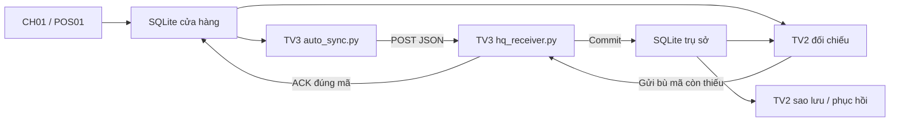

# BÁO CÁO KIỂM THỬ TÍCH HỢP THỬ NGHIỆM TV2–TV3

**Đề tài:** Thiết kế hạ tầng CNTT cho chuỗi cửa hàng bán lẻ.  
**Phạm vi:** Python, SQLite và HTTP trên một máy Windows; một cửa hàng CH01, một POS01.  
**Kết luận:** Hai giai đoạn đã ĐẠT trong phạm vi đã chạy. Đây là bản tích hợp thử nghiệm để bàn giao và xem xét, chưa phải bản tích hợp chính thức trong repository nhóm.

Báo cáo được tổng hợp từ mã nguồn, log và bản chụp dữ liệu đã lưu. Trong lần lập tài liệu này không chạy lại kiểm thử, không mở dịch vụ và không sửa CSDL. Các tài liệu README, kế hoạch, ghi chú và manifest ban đầu được giữ nguyên theo mốc chuẩn bị; những dòng “chưa chạy” trong đó cần được đọc theo mốc lịch sử. Kết quả thực tế hiện được dẫn trong báo cáo này.

## 1. Mục tiêu và phiên bản nguồn

TV3 cung cấp cơ chế lưu giao dịch trước khi gửi, quản lý trạng thái và tự gửi lại khi dịch vụ trụ sở phục hồi. TV2 bổ sung đối chiếu, sao lưu, phục hồi CSDL trụ sở và gửi bù giao dịch thiếu sau phục hồi. Mục tiêu thử nghiệm là ghép các chức năng này mà giữ lại phần đã hoàn thành của từng thành viên.

| Nguồn | Commit cố định |
|---|---|
| TV3 | `2159cc8987e44a53e20ce4ee3bded194e8122969` |
| TV2 | `f4aeed5d29bc72e7a07e73d3c9ff1a5cb3152af8` |

Mã nguyên gốc nằm trong `Nguon/`; mã mẫu dùng trong bản thử nằm trong `Script/`. [NGUON_GIT.json](NGUON_GIT.json) và [MANIFEST.json](MANIFEST.json) lưu nguồn và hash ở mốc chuẩn bị. [NGUON_VA_DIEU_CHINH.md](NGUON_VA_DIEU_CHINH.md) mô tả các điều chỉnh.

**Schema `truso.db` của TV3 là lựa chọn tạm thời cho bản thử; cần TV2 xác nhận trước khi tích hợp chính thức.**

## 2. Kiến trúc và luồng xử lý

1. `store_agent.py` ghi giao dịch xuống SQLite trước khi gửi. Mã giao dịch chứa cửa hàng, POS, ngày và số thứ tự; bảng `bo_dem` giữ số thứ tự trên đĩa.
2. `auto_sync.py` gọi hàm gửi của TV3, chọn giao dịch `PENDING/SENT`, rồi chờ 10 giây sau khi kết thúc mỗi lượt. Thời gian xử lý lượt gửi cộng thêm vào khoảng cách giữa hai lần bắt đầu; không hiểu là gửi chính xác mỗi 10 giây.
3. Receiver nhận JSON tại `http://127.0.0.1:18000/giao-dich`, kiểm tra dữ liệu, lưu và commit trước khi ACK. Mã đã có và nội dung giống nhau được trả `DA_TON_TAI` mà không thêm bản ghi.
4. Cửa hàng chỉ chuyển sang `ACKED` khi phản hồi là object, `ack=true` và đúng `ma_gd`. Gửi lỗi không xóa giao dịch.
5. TV2 đọc hai CSDL để đối chiếu năm trường, tìm mã thiếu, lệch nội dung và mã trùng. Sau phục hồi, `gui-bu` gửi riêng các giao dịch đã ACKED nhưng trụ sở thiếu.
6. Bộ điều khiển quản lý tiến trình receiver và auto sync trong từng phiên. Phục hồi tắt cả hai, tạo bản sao hiện trạng rồi khôi phục bản được chọn; sender không tự bật lại.

| Trạng thái | Ý nghĩa |
|---|---|
| PENDING | Đã lưu cục bộ, chưa thử gửi |
| SENT | Đã thử gửi, chưa nhận ACK hợp lệ; riêng trạng thái này không kết luận được trụ sở đã lưu hay chưa |
| ACKED | Đã nhận ACK hợp lệ tại thời điểm gửi; trụ sở vẫn có thể thiếu lại nếu sau đó phục hồi bản sao cũ |

Dữ liệu truyền gồm `ma_gd`, `ma_cua_hang`, `ma_may`, `thoi_gian`, `so_tien`. Trạng thái và bộ đếm thuộc kho cửa hàng. Schema trụ sở được lưu ở [SCHEMA_TAM_THOI.sql](SCHEMA_TAM_THOI.sql). Bản thử sử dụng localhost, không truyền qua WAN Packet Tracer.

## 3. Giai đoạn 1: giữ dữ liệu và tự gửi lại

Phiên: [Phien_20261109_014617_838147](PhienThu/Phien_20261109_014617_838147). Theo kết quả đã lưu, thời gian chạy là 01:46:17–01:46:42 ngày 09/11/2026, múi giờ +07:00.

| Ca thực tế | Kết quả | Đánh giá |
|---|---|---|
| Khởi động, tạo phiên riêng | Kho mới rỗng; dịch vụ không tự bật khi mở bộ điều khiển | Đạt |
| Đối chiếu ban đầu | Cửa hàng 0, trụ sở 0; báo chưa đạt và trả mã 2 | Đạt ca âm, không kết luận nhầm 0/0 |
| Bật rồi dừng receiver | Receiver dùng cổng 18000; sau dừng cổng được giải phóng | Đạt |
| Tạo khi dịch vụ tắt | Tạo đúng 5 giao dịch PENDING | Đạt |
| Auto sync khi dịch vụ tắt | 5 lần lỗi WinError 10061; giữ đủ 5 SENT, trụ sở 0 | Đạt |
| Khởi động lại receiver | Cùng tiến trình auto sync tự gửi đủ 5, không gọi gửi thủ công | Đạt |
| Đối chiếu cuối | Cửa hàng 5, ACKED 5, trụ sở 5; năm trường khớp, mã trùng 0 | Đạt |
| Kết thúc | Bộ điều khiển thoát mã 0, các tiến trình của phiên dừng, cổng được giải phóng | Đạt |

Minh chứng: [kết quả JSON](PhienThu/Phien_20261109_014617_838147/MinhChung/KET_QUA_GIAI_DOAN_1.json), [Terminal](PhienThu/Phien_20261109_014617_838147/MinhChung/terminal_giai_doan_1.txt), [auto sync](PhienThu/Phien_20261109_014617_838147/MinhChung/auto_sync_log.txt), [receiver](PhienThu/Phien_20261109_014617_838147/MinhChung/receiver_log.txt), [log điều khiển](PhienThu/Phien_20261109_014617_838147/MinhChung/dieu_khien_log.txt).

Các bản chụp riêng: [ban đầu 0/0](PhienThu/Phien_20261109_014617_838147/MinhChung/GD1_BAN_DAU_0_0.json), [5 PENDING](PhienThu/Phien_20261109_014617_838147/MinhChung/GD1_TAO_5_PENDING.json), [5 SENT khi mất dịch vụ](PhienThu/Phien_20261109_014617_838147/MinhChung/GD1_MAT_DICH_VU_5_SENT.json), [5 ACKED sau đồng bộ](PhienThu/Phien_20261109_014617_838147/MinhChung/GD1_SAU_DONG_BO_5_ACKED.json).

Trong bản chụp 0/0, hai danh sách cùng rỗng nên phép so sánh năm trường trả true. Đây không phải bằng chứng đồng bộ thành công; công cụ đối chiếu đã từ chối đúng trường hợp này.

## 4. Giai đoạn 2: chống trùng, sao lưu, phục hồi và gửi bù

Phiên: [Phien_GD2_20261109_020609_227458](PhienThu/Phien_GD2_20261109_020609_227458). Theo kết quả đã lưu, thời gian chạy là 02:06:09–02:06:13 ngày 09/11/2026, múi giờ +07:00.

Hai CSDL 5 giao dịch được sao chép bằng SQLite backup từ nguồn mở chỉ đọc của giai đoạn 1 sang phiên mới. Mã mẫu và đường dẫn dữ liệu được kiểm tra theo phiên mới; toàn bộ phiên giai đoạn 1 được giữ nguyên.

| Bước thực tế | Kết quả | Đánh giá |
|---|---|---|
| Sao chép và kiểm tra ban đầu | Cửa hàng 5, ACKED 5, trụ sở 5; dữ liệu và bộ đếm khớp nguồn | Đạt |
| Gửi lặp 5 giao dịch | 5 ACK DA_TON_TAI; trụ sở vẫn 5, không trùng | Đạt |
| Sao lưu bằng TV2 | Bản sao 5 giao dịch, dữ liệu khớp, integrity_check ok | Đạt |
| Tạo thêm và đồng bộ | Tạo đúng 5 mã mới; cửa hàng và trụ sở đạt 10, ACKED 10 | Đạt |
| Dừng trước phục hồi | Receiver và auto sync đều dừng | Đạt |
| Phục hồi bản sao 5 | Trụ sở 10 → 5; CSDL cửa hàng giữ nguyên byte với 10 ACKED | Đạt |
| Đối chiếu sau phục hồi | Phát hiện đúng 5 giao dịch ACKED bị thiếu; trả mã 2, không báo khớp | Đạt ca phát hiện thiếu |
| Khởi động receiver, gửi bù | Sender nền tắt; TV2 gửi đúng 5 mã thiếu, nhận 5/5 ACK | Đạt |
| Đối chiếu cuối và dừng | Hai bên 10, ACKED 10, dữ liệu khớp, trùng 0; bản sao 5 giữ nguyên hash; các tiến trình dừng | Đạt |

Năm mã được gửi bù là `CH01-POS01-20261109-000006` đến `CH01-POS01-20261109-000010`. Chúng là năm giao dịch mới tạo trong giai đoạn 2.

### Các mốc số liệu thực tế

| Mốc | Cửa hàng | Trạng thái cửa hàng | Trụ sở | ACKED mà trụ sở thiếu |
|---|---:|---|---:|---:|
| Bản sao ban đầu | 5 | ACKED 5 | 5 | 0 |
| Vừa tạo thêm 5 | 10 | ACKED 5, PENDING 5 | 5 | 0 |
| Đồng bộ trước phục hồi | 10 | ACKED 10 | 10 | 0 |
| Phục hồi bản sao 5 | 10 | ACKED 10 | 5 | 5 |
| Gửi bù hoàn tất | 10 | ACKED 10 | 10 | 0 |

Chuỗi **5 → 10 → 5 → 10** mô tả số bản ghi tại trụ sở. Kho cửa hàng không bị đưa về 5 khi phục hồi trụ sở. Bộ 5 ban đầu của giai đoạn 2 là bản sao bộ 5 giai đoạn 1; không cộng hai bản sao thành 10. Bộ 10 chỉ hình thành sau khi tạo thêm 5 giao dịch mới.

Minh chứng chính: [kết quả JSON](PhienThu/Phien_GD2_20261109_020609_227458/MinhChung/KET_QUA_GIAI_DOAN_2.json), [Terminal](PhienThu/Phien_GD2_20261109_020609_227458/MinhChung/terminal_giai_doan_2.txt), [log điều khiển](PhienThu/Phien_GD2_20261109_020609_227458/MinhChung/dieu_khien_log.txt), [auto sync](PhienThu/Phien_GD2_20261109_020609_227458/MinhChung/auto_sync_log.txt), [receiver](PhienThu/Phien_GD2_20261109_020609_227458/MinhChung/receiver_log.txt).

## 5. Danh mục dữ liệu và minh chứng bàn giao

| Nội dung | File thực tế |
|---|---|
| Hai CSDL giai đoạn 1 | [cuahang01.db](DU_LIEU_KHONG_DONG_GOI.md), [truso.db](DU_LIEU_KHONG_DONG_GOI.md) |
| Hai CSDL cuối giai đoạn 2 | [cuahang01.db](DU_LIEU_KHONG_DONG_GOI.md), [truso.db](DU_LIEU_KHONG_DONG_GOI.md) |
| Nguồn sao chép giai đoạn 2 | [GD2_NGUON_SAO_CHEP.json](PhienThu/Phien_GD2_20261109_020609_227458/MinhChung/GD2_NGUON_SAO_CHEP.json) |
| Mốc đầu 5 ACKED | [GD2_BAN_DAU_5_ACKED.json](PhienThu/Phien_GD2_20261109_020609_227458/MinhChung/GD2_BAN_DAU_5_ACKED.json) |
| Sau gửi lặp 5 | [GD2_SAU_GUI_LAP_5.json](PhienThu/Phien_GD2_20261109_020609_227458/MinhChung/GD2_SAU_GUI_LAP_5.json) |
| Mốc thêm 5 PENDING | [GD2_THEM_DUNG_5_PENDING.json](PhienThu/Phien_GD2_20261109_020609_227458/MinhChung/GD2_THEM_DUNG_5_PENDING.json) |
| Trước phục hồi: 10 ACKED | [GD2_TRUOC_PHUC_HOI_10_ACKED.json](PhienThu/Phien_GD2_20261109_020609_227458/MinhChung/GD2_TRUOC_PHUC_HOI_10_ACKED.json) |
| Sau phục hồi: kho 10, HQ 5 | [GD2_SAU_PHUC_HOI_KHO10_HQ5.json](PhienThu/Phien_GD2_20261109_020609_227458/MinhChung/GD2_SAU_PHUC_HOI_KHO10_HQ5.json) |
| Danh sách 5 mã thiếu | [GD2_PHAT_HIEN_5_MA_THIEU.json](PhienThu/Phien_GD2_20261109_020609_227458/MinhChung/GD2_PHAT_HIEN_5_MA_THIEU.json) |
| Sau gửi bù: 10 ACKED | [GD2_SAU_GUI_BU_10_ACKED.json](PhienThu/Phien_GD2_20261109_020609_227458/MinhChung/GD2_SAU_GUI_BU_10_ACKED.json) |
| Bản sao HQ tại mốc 5 | [truso_20261109_020610_619085.db](DU_LIEU_KHONG_DONG_GOI.md) |
| Bản sao an toàn 10 trước phục hồi | [truso_20261109_020611_690229.db](DU_LIEU_KHONG_DONG_GOI.md) |
| Kiểm tra nội dung bản sao | [bản 5](PhienThu/Phien_GD2_20261109_020609_227458/MinhChung/GD2_BAN_SAO_HQ_5.json), [bản an toàn 10](PhienThu/Phien_GD2_20261109_020609_227458/MinhChung/GD2_BAN_SAO_AN_TOAN_TRUOC_PHUC_HOI.json) |
| Bản sao 5 giữ nguyên hash | [GD2_XAC_NHAN_BAN_SAO_5_CON_NGUYEN.json](PhienThu/Phien_GD2_20261109_020609_227458/MinhChung/GD2_XAC_NHAN_BAN_SAO_5_CON_NGUYEN.json) |
| Bảo toàn toàn bộ giai đoạn 1 | [BAO_TOAN_GIAI_DOAN_1.json](PhienThu/Phien_GD2_20261109_020609_227458/MinhChung/BAO_TOAN_GIAI_DOAN_1.json) |

Bản sao 5 có SHA-256 trước và sau thử giống nhau: `645536ab69375d9aa97b34ac4d91c8ffe2cd6e760cc908f890472af58cc28550`. Kết quả giai đoạn 2 ghi 51 file có sẵn không thay đổi. Các bản chụp cuối và bản sao HQ trong giai đoạn 2 ghi `integrity_check = ok`.

## 6. Phân biệt đã thử và chưa thử

| Chức năng hoặc tình huống | Trạng thái trong hai phiên |
|---|---|
| Giữ PENDING/SENT khi receiver tắt, tự gửi khi bật lại | Đã thử, đạt |
| Kiểm tra ACK trên luồng gửi thành công | Đã thử; chưa gây ACK sai mã hoặc sai định dạng |
| Gửi lặp cùng mã, cùng nội dung | Đã thử với 5 giao dịch, đạt |
| Sao lưu HQ, phục hồi bản 5, phát hiện thiếu và gửi bù | Đã thử, đạt |
| Từ chối coi hai CSDL rỗng là đồng bộ thành công | Đã thử, đạt ca âm |
| HTTP 409: cùng mã khác nội dung | Có nhánh mã, chưa kiểm thử riêng |
| Mất phản hồi ACK sau khi trụ sở commit | Chưa kiểm thử; không suy ra từ lỗi từ chối kết nối |
| Nhiều cửa hàng, nhiều POS hoặc gửi đồng thời | Chưa triển khai/kiểm thử trong bản này |
| WAN thật, HTTP Python đi qua WAN Packet Tracer | Chưa kiểm thử; hai phiên chỉ dùng localhost |
| Xuất CSV, sao lưu và phục hồi kho cửa hàng trong bản tích hợp | Có công cụ, chưa chạy trong hai phiên này |
| Thiếu file CSDL hoặc sai schema | Có xử lý báo lỗi trong bản sao, chưa gây lỗi riêng để kiểm thử |
| Gửi lặp toàn bộ 10 sau gửi bù, phục hồi lặp nhiều lần | Có trong kế hoạch, chưa thực hiện |
| Tắt cưỡng bức, mất điện hoặc nhánh kill do timeout | Chưa kiểm thử |
| Lịch sao lưu tự động, chuyển bản sao sang Server-Backup, TLS/xác thực | Chưa tích hợp/kiểm thử |

Các ca 0/0 và thiếu 5 sau phục hồi trả mã 2 là kết quả mong đợi của phép thử phát hiện tình trạng chưa đạt. Hai ca này không làm cho toàn bộ kịch bản bị đánh giá thất bại.

## 7. Giới hạn và điều kiện bàn giao

Bản thử chỉ có CH01/POS01; công cụ đối chiếu cần đọc hai file SQLite trên cùng máy. Chưa có cơ chế đối chiếu qua mạng giữa các máy độc lập, chưa đánh giá tải hoặc độ bền dài hạn.

Receiver chỉ nghe localhost cổng 18000. Khi triển khai mạng thật cần chốt địa chỉ, cổng, bảo mật và ACL; không áp trực tiếp cổng thử vào mô hình mạng mà chưa thống nhất. Bản thử giữ mọi bản sao để bảo toàn minh chứng, khác chính sách giữ 7 bản của TV2 gốc.

Bộ điều khiển Terminal chưa có lệnh nạp lại phiên đã tồn tại. Giai đoạn 2 đã dùng lớp Demo hiện có để trỏ tới phiên mới được sao chép; không sửa kiến trúc. Hướng dẫn trình diễn dành cho lần sau dùng một phiên mới từ đầu, còn hai phiên đã đạt giữ nguyên làm minh chứng.

Có thể bàn giao bản thử, mã, tài liệu và minh chứng cho TV2 để rà soát. Trước khi ghép repository chính cần xác nhận schema, lựa chọn các điều chỉnh cần giữ, bổ sung kiểm thử còn thiếu và thống nhất tài liệu nhóm. Không dùng bộ 15 giao dịch TV3 gốc hoặc log 45 giao dịch TV2 để thay cho minh chứng của hai phiên này.

Đọc tiếp [hướng dẫn demo nhóm](HUONG_DAN_DEMO_NHOM.md) và [bàn giao cho TV2](BAN_GIAO_CHO_TV2.md).
