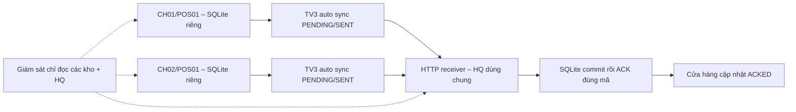

# TV3 – Tổng kết cho cuộc họp nhóm

**Bản trình bày khoảng 5 phút.** Nhánh làm việc: `tv3-nang-cao-demo`, xuất phát từ `c88fdb9`. Bản nâng cao được quản lý riêng trên nhánh này; đây vẫn là bản thử nghiệm trên localhost, chưa merge vào dự án chính.

## 1. Phần em đã hoàn thành

TV3 lưu giao dịch xuống SQLite trước khi gửi, sinh mã có bộ đếm theo ngày, quản lý PENDING/SENT/ACKED, gửi lại và kiểm tra ACK đúng mã. Trụ sở commit trước khi xác nhận; mã trùng cùng nội dung không tạo bản ghi mới, khác nội dung trả HTTP 409. Em có công cụ xuất CSV, sao lưu và thử phục hồi kho cửa hàng.

Trong bản tích hợp đã đạt trước đây, TV3 phụ trách luồng lưu/gửi/ACK và tự đồng bộ; TV2 cung cấp đối chiếu, sao lưu/phục hồi trụ sở và gửi bù. Bộ điều khiển, cô lập phiên, giới hạn cổng và các điều chỉnh tương thích là phần được xây dựng trong môi trường thử tích hợp, chưa phải chức năng đã merge vào dự án nhóm.

## 2. Nâng cấp lần này

- Giám sát Terminal: tổng giao dịch từng kho, PENDING/SENT/ACKED, tổng HQ, số chưa ACK, thiếu/thừa/lệch/trùng và cảnh báo. Mở SQLite bằng mode=ro và query_only; xem thống kê không sửa dữ liệu.
- Cấu hình mã cửa hàng/POS, file dữ liệu riêng, chặn dùng nhầm file của cặp khác và kiểm tra tiền nguyên dương.
- Demo hai cửa hàng cùng receiver, sender riêng; có thể mô phỏng chặn HTTP một cửa hàng trong khi cửa hàng kia tiếp tục chạy.
- Giữ công cụ cũ cố định CH01 trong chế độ một kho; chặn dùng nhầm khi chuyển sang nhiều kho.

Không đổi schema hoặc mã nguồn tham chiếu TV2/TV3. Receiver và auto_sync.py giữ nguyên. Chờ 10 giây là sau mỗi lượt xử lý, không phải cam kết mỗi giao dịch được nhận sau 10 giây.

## 3. Luồng giao dịch

Khi chưa có ACK hợp lệ, dữ liệu ở cửa hàng vẫn còn để gửi lại. Sau khi phục hồi HQ từ bản cũ, ACKED ở cửa hàng có thể vẫn tồn tại dù HQ thiếu; công cụ TV2 phát hiện và gửi bù trong phạm vi một cửa hàng đã tích hợp.

## 4. Kết quả có minh chứng

| Nhóm | Kết quả thực tế |
|---|---|
| ACK sai mã, JSON mảng, JSON lỗi, ack=false/1/"true"/thiếu ack | 7 ca ĐẠT; mỗi ca giữ SENT 1, ACKED 0; sau đổi receiver thật đạt ACKED 1/HQ 1 |
| Dịch vụ tắt khi chờ 20 giao dịch | Giữ đủ SENT 20; cùng tiến trình auto sync tự gửi sau khôi phục; cuối ACKED 20/HQ 20; gửi lặp không tăng bản ghi |
| Hai cửa hàng, mỗi nơi 5 | Khi chặn HTTP CH02: CH01 ACKED 5, CH02 SENT 5, HQ 5. Nối lại: tổng ACKED 10/HQ 10, năm trường khớp, không trùng |
| Giám sát và cấu hình | Không kết luận từ 0/0; báo thiếu DB/sai schema/lệch nội dung; hash DB không đổi khi xem; bộ đếm không reset giữa hai tiến trình |
| Hồi quy | HTTP 409, mất ACK và năm nhóm bộ điều khiển ĐẠT 7/7; thoát CLI hai sender dọn đủ ba tiến trình |
| Giới hạn công cụ cũ | Ca riêng ĐẠT: chặn 5 lệnh cố định CH01 trong phiên nhiều kho, không có tác dụng phụ |

Tổng cộng 13 ca nâng cao, 7 ca hồi quy và 2 ca giới hạn/an toàn đạt. Lệnh nối lại cũng đã thử từ chối cổng do thành phần ngoài phiên giữ, không bật sender. Các bộ dữ liệu độc lập; không cộng số giao dịch giữa các phiên. [Báo cáo và log](TV3_BAO_CAO_NANG_CAO.md) ghi thời điểm và phiên bản mã tương ứng. Hai giai đoạn cũ không chạy lại.

## 5. Đề nghị nhóm thống nhất

TV2 cần xác nhận schema năm trường đang dùng tạm, cách chuyển truy vấn SQL cũ và chính sách sao lưu/gửi bù. Bộ mới đã thử hai cửa hàng, mỗi cửa hàng một POS logic; chưa thử hai POS cùng cửa hàng. Công cụ đối chiếu/gửi bù TV2 hiện chỉ hỗ trợ phiên một CH01/POS01; demo nhiều kho dùng giám sát TV3, chưa có gửi bù TV2 nhiều cửa hàng. Sao lưu/phục hồi kho cửa hàng và CSV cũng chưa mở rộng nhiều kho.

Nhóm còn cần chọn phạm vi tích hợp chính thức, cấu hình địa chỉ/bảo mật, chính sách lưu bản sao và kiểm thử trên các máy độc lập. Hai cửa hàng hiện là hai kho/process trên cùng laptop; chưa chứng minh nhiều POS thực tế, tải đồng thời lớn hoặc Python đi qua WAN Packet Tracer. GET kiểm tra dịch vụ chỉ cho biết có phản hồi HTTP, không xác thực receiver.

Khi trình diễn, dùng [kịch bản demo](TV3_HUONG_DAN_DEMO_NANG_CAO.md), tạo phiên mới và thoát bằng thoat. Những gì chưa thử vẫn được ghi rõ; bản này sẵn sàng để nhóm xem và phản biện, chưa phải nghiệm thu hệ thống chính thức.
